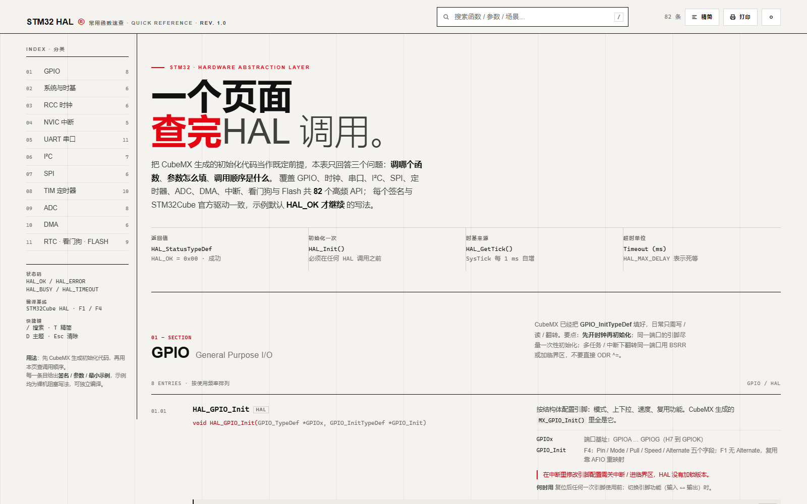

# STM32 HAL · 常用函数速查

一个**单文件、离线可用**的 STM32 HAL 库速查表页面。把 CubeMX 生成的初始化代码当作既定前提，
本表只回答三个问题：**调哪个函数、参数怎么填、调用顺序是什么**。

**在线访问：** https://kuada1.github.io/stm32-hal-quickref/

## 内容

- 12 个分类、82 条高频 API：GPIO、系统与时基、RCC 时钟、NVIC 中断、UART、I²C、SPI、
  定时器、ADC、DMA、RTC / 看门狗 / FLASH。
- 每条包含：函数签名、参数语义（表格）、返回值、最小可运行示例、常见坑与调用顺序。
- 顶部搜索框（/ 聚焦）、分类导航、精简模式、打印样式、明暗主题切换。
- 瑞士国际主义风格：严格网格、纸色/墨黑/单一红、等宽代码块。

## 本地使用

直接用浏览器打开 index.html 即可，不需要服务器、不依赖任何 CDN 或外部字体。

## 快捷键

| 键 | 作用 |
|---|---|
| / | 聚焦搜索 |
| T | 切换主题 |
| D | 精简 / 完整模式 |
| Esc | 清除搜索 |

## 说明

页面中的所有代码示例均为裸机阻塞写法，可独立编译；默认 HAL_OK 才继续。
内容与 STM32Cube 官方驱动保持一致，适用于 STM32F1 / F4 系列。
